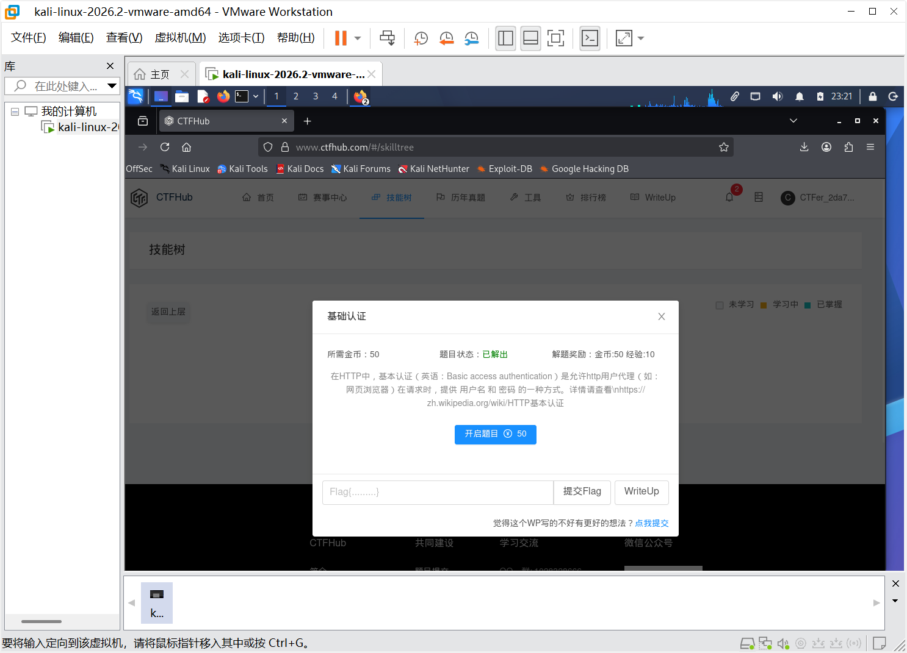

# WP：基础认证

> **CTFHub 路径**：技能树 → Web → Web 前置技能 → HTTP 协议 → 基础认证
> **任务**：按题目提示完成 HTTP Basic 认证，拿到 flag。
> **提示**：观察 `401 Unauthorized` 响应和 `WWW-Authenticate: Basic` 响应头。Basic 认证把 `用户名:密码` 做 Base64 编码后放在 `Authorization` 请求头里，Base64 不是加密。
> **截图要求**：能看到 `Authorization: Basic ...` 请求头，以及认证成功后的 flag 或页面。

---

## 题目信息

| 项目 | 内容 |
| --- | --- |
| 环境地址 | http://challenge-<hash>.sandbox.ctfhub.com:10800/（每次开启题目分配不同子域名） |
| Flag | ctfhub{example_flag_placeholder} |

## 解题过程

首次访问靶场首页时，服务器返回 401 Unauthorized，响应头中包含 `WWW-Authenticate: Basic realm="..."`，浏览器弹出了用户名/密码登录框。题目提示基本认证，结合常见弱口令，我尝试用户名 `admin`、密码 `admin`。在 Burp Repeater 中，把 `admin:admin` 做 Base64 编码得到 `YWRtaW46YWRtaW4=`，然后在请求头中添加 `Authorization: Basic YWRtaW46YWRtaW4=` 后发送。服务器返回 200 OK，响应体中显示了 flag。

## 关键请求/响应

```http
GET / HTTP/1.1
Host: challenge-<hash>.sandbox.ctfhub.com:10800
Authorization: Basic YWRtaW46YWRtaW4=

HTTP/1.1 200 OK
Content-Type: text/html; charset=UTF-8

ctfhub{...}
```

## 原理与复盘

这道题对应 HTTP 报文的 **请求头 Authorization**。Basic 认证只是把 `用户名:密码` 用 Base64 编码后放在请求头里传输；Base64 不是加密，只是编码，任何人拿到后都能解码还原出原始明文。因此弱口令 + Basic 认证非常危险，攻击者一旦截获请求或直接猜测密码就能绕过认证。

---

## 截图



> 可以在这份 WP 中另加过程截图；检查时只看指定图片，额外图片不检查。
