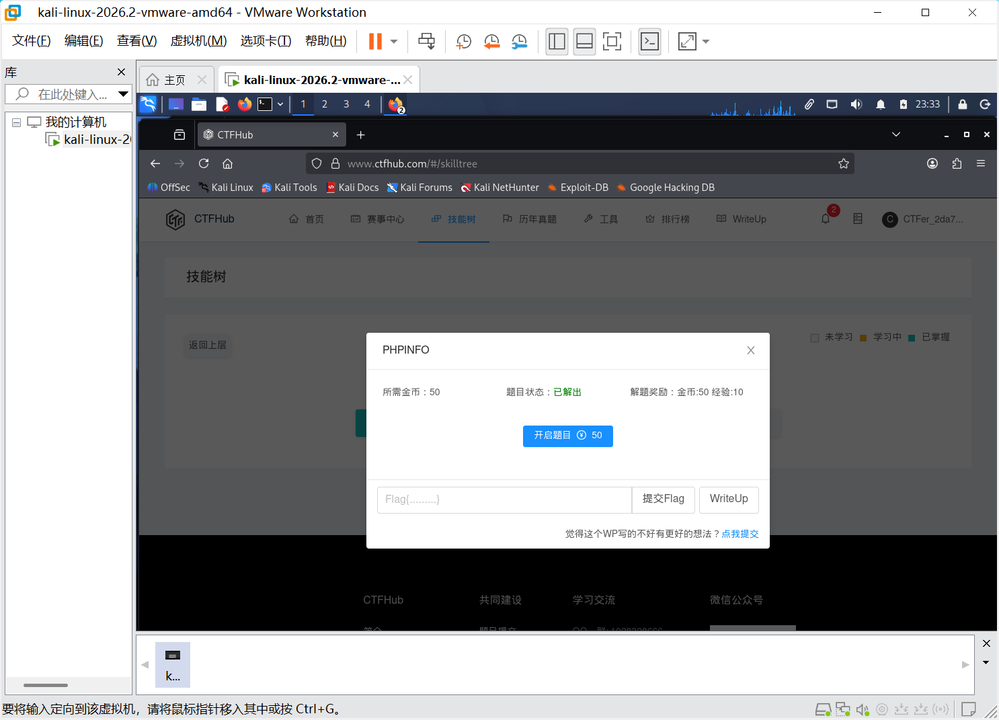

# WP：PHPINFO

> **CTFHub 路径**：技能树 → Web → 信息泄露 → PHPINFO
> **任务**：在 phpinfo 页面中找到 flag，并观察它泄露了哪些信息。
> **提示**：phpinfo 会输出大量 PHP 和服务器配置。用浏览器的查找功能搜索关键字，同时留意页面暴露的路径、版本、环境变量等信息。
> **截图要求**：能看到 phpinfo 页面、你搜索/定位到的 flag，以及至少一处敏感信息。

---

## 题目信息

| 项目 | 内容 |
| --- | --- |
| 环境地址 | http://challenge-<hash>.sandbox.ctfhub.com:10800/phpinfo.php（每次开启题目分配不同子域名） |
| Flag | ctfhub{example_flag_placeholder} |

## 解题过程

开启题目后，根据题目提示直接访问 `/phpinfo.php`，页面显示的是 PHP 的 `phpinfo()` 输出，包含了大量服务器配置信息。由于页面内容很长，我使用浏览器查找功能（`Ctrl + F`）搜索关键字 `flag`，在页面中定位到一个自定义字段（或环境变量）里存放的 flag。同时观察到页面还暴露了 PHP 版本、Server API、DOCUMENT_ROOT、已加载扩展、环境变量等信息。

## 关键请求/响应

```http
GET /phpinfo.php HTTP/1.1
Host: challenge-<hash>.sandbox.ctfhub.com:10800

HTTP/1.1 200 OK
Content-Type: text/html; charset=UTF-8

...（phpinfo 页面 HTML，其中包含 flag）...
```

## 原理与复盘

phpinfo 页面属于 **响应体** 信息泄露。它会无差别地输出 PHP 运行环境、服务器路径、扩展版本、环境变量等敏感配置。攻击者可以利用这些信息判断服务器是否存在已知漏洞、定位 Web 根目录、构造后续攻击 payload。

---

## 截图



> 可以在这份 WP 中另加过程截图；检查时只看指定图片，额外图片不检查。
